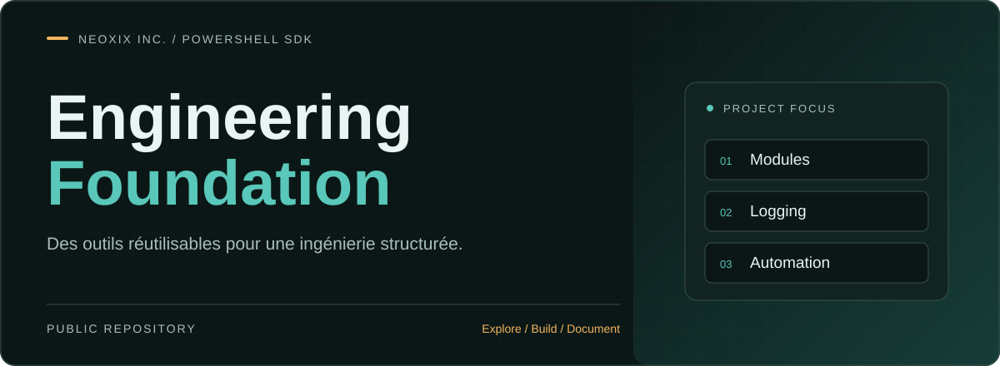

<!-- BEGIN NEOXIX REPOSITORY PRESENTATION -->
<p align="center">
  
</p>

<p align="center"><strong>Fondation PowerShell réutilisable : modules, journalisation et détection d’environnement.</strong></p>

<p align="center">


</p>

<p align="center"><a href="examples">Exemples</a> · <a href="docs">Documentation</a> · <a href="CONTRIBUTING.md">Contribuer</a></p>
<!-- END NEOXIX REPOSITORY PRESENTATION -->

---

# Neoxix SDK

Neoxix SDK is the reusable PowerShell engineering foundation for repositories maintained by Neoxix Inc. It provides a testable module architecture, runtime metadata, structured logging, and read-only environment detection.

> **Early development:** version 0.1.0 establishes the foundation only. APIs may evolve before a stable release.

## Target compatibility

- Windows PowerShell 5.1: validated locally.
- PowerShell 7 and later on Windows and Linux: targeted by the implementation and configured in CI. Treat this target as validated only after the first successful CI matrix run.

## Install from source

Clone the repository, then import the manifest directly:

```powershell
Import-Module .\src\Neoxix.SDK\Neoxix.SDK.psd1 -Force
```

No PowerShell Gallery package is published by this repository.

## Quick start

```powershell
Import-Module .\src\Neoxix.SDK\Neoxix.SDK.psd1 -Force
Get-NeoxixSdkInfo
Get-NeoxixEnvironment

Start-NeoxixLog -Path .\neoxix.log -EnableDebug
Write-NeoxixInfo -Message 'Work started.'
Write-NeoxixSuccess -Message 'Work completed.'
Stop-NeoxixLog
```

## Foundation commands

- `Get-NeoxixSdkInfo`
- `Get-NeoxixEnvironment`
- `Start-NeoxixLog` and `Stop-NeoxixLog`
- `Write-NeoxixInfo`, `Write-NeoxixSuccess`, and `Write-NeoxixWarning`
- `Write-NeoxixError` and `Write-NeoxixDebug`

## Logging security

Log messages are normalized to one physical line. Recognizable named secrets, bearer credentials, common token formats, and private-key blocks are replaced with redaction markers before objects are returned or files are written. This is a defense-in-depth control, not permission to pass secrets to logging APIs.

## Environment detection

`Get-NeoxixEnvironment` returns one pipeline-safe object describing the platform, runtime, CI provider, SDK support, and local availability of Git, GitHub CLI, Visual Studio Code, Docker, Pester, and PSScriptAnalyzer. Detection is read-only, uses no network, and does not inspect authentication state.

See the [environment detection API documentation](docs/api/Get-NeoxixEnvironment.md).

## Development

Install missing development modules after reviewing the script:

```powershell
.\tools\Install-Dependencies.ps1
```

Run validation:

```powershell
Invoke-ScriptAnalyzer -Path .\src\Neoxix.SDK -Recurse -Settings .\PSScriptAnalyzerSettings.psd1
Invoke-Pester -Path .\tests -CI
.\build\build.ps1 -Task Validate
```

Build output is generated under `out/`.

## Repository structure

- `src/Neoxix.SDK/`: distributable PowerShell module
- `tests/`: Pester unit and integration tests
- `build/`: deterministic build entry point
- `tools/`: dependency bootstrap
- `docs/`: specifications, missions, ADRs, and architecture notes
- `examples/` and `templates/`: navigation for future documented assets

The `CODEOWNERS` team slug is provisional and must be confirmed by an organization administrator before branch protection relies on it.

## Security, contributing, and license

Do not disclose vulnerabilities in public issues. Read [SECURITY.md](SECURITY.md) for private reporting guidance.

Contributions must follow [CONTRIBUTING.md](CONTRIBUTING.md). The project is licensed under the [MIT License](LICENSE).
